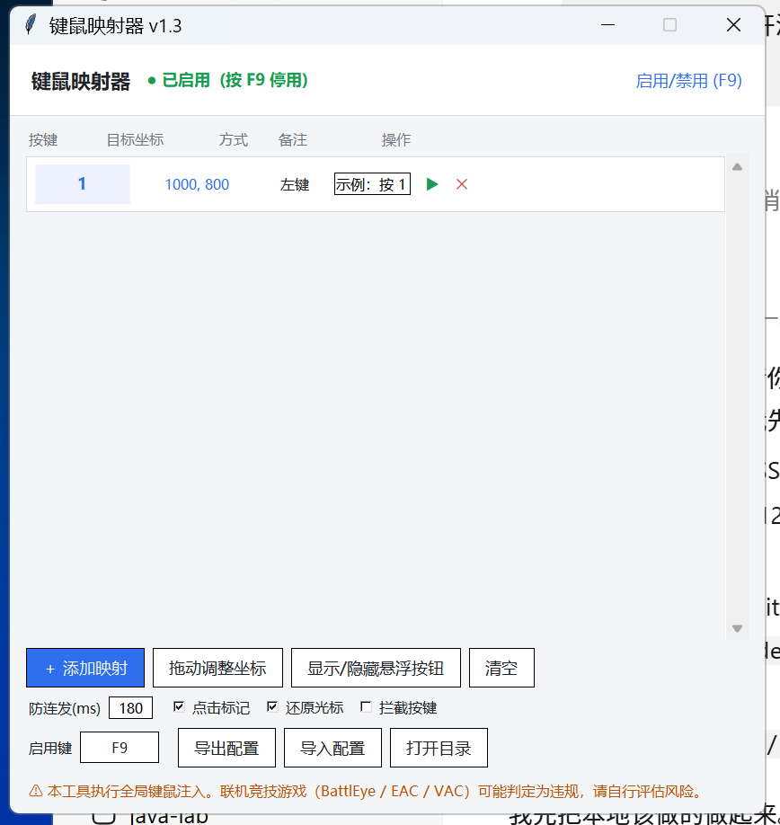
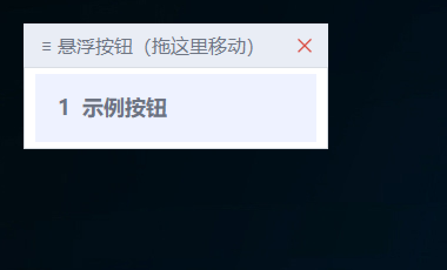

# 键鼠映射器 KeyClicker

> **把键盘按键映射成「在屏幕指定坐标点击鼠标」的 Windows 小工具。** 按一下键 = 在固定位置点一下鼠标，还带一个可拖动的屏幕悬浮按钮面板。
> 纯 Python 标准库 + Win32 API 实现，**零第三方依赖、绿色免安装、开源免费**。


**关键词**：键鼠映射器 · 按键映射 · 改键工具 · 鼠标连点器 · 自动点击器 · 坐标点击 · 屏幕点击工具 · 快捷键点击 · 宏工具 · 悬浮按钮面板 · 按钮大小可调 · Windows 自动化 · 模拟器点击辅助 · 办公自动化 · AutoHotkey 替代 · 按键精灵替代 · 鼠标宏 · 多点位点击 · Win32 API · ctypes · tkinter · 开源免费 · 绿色免安装

---

## 这个工具解决什么问题

有些界面上的按钮**位置固定、但每次都得手动去点**：模拟器里的固定操作、老旧业务系统、教学软件、批量确认弹窗、重复性的表格录入……

KeyClicker 让你把这些「固定位置的点击」绑到键盘上：**按一下键，就在那个坐标点一下鼠标**。手不用离开键盘，效率立刻不一样。

它不做图像识别、不读内存、不改游戏数据 —— 只做一件事：**键 → 坐标点击**。所以它足够小、足够快、足够可预期。

**典型使用场景**

| 场景 | 怎么用 |
|---|---|
| 模拟器 / 手游助手里的固定按钮 | 把常用功能绑到 `1~9`，比用鼠标找按钮快得多 |
| 老系统 / 内网软件的重复点击 | 一晚上要确认几百次的弹窗，一个键解决 |
| 多屏 / 大屏上的固定位置操作 | 光标不用长距离移动，直接「瞬移点击」 |
| 教学演示、录屏操作 | 悬浮面板点一下就到位，动作干净 |
| 自己写的自动化流程 | 作为「坐标点击」这一环的最简实现 |
| 单机 / 离线场景的重复操作 | 请先阅读下方风险声明 |

## 功能特性

| 特性 | 说明 |
|---|---|
| 🎯 按键 → 坐标点击 | 任意键位映射到屏幕任意坐标；支持**左键 / 右键 / 中键**，可选**双击** |
| 🖱️ 悬浮按钮面板 | 独立的可拖动小面板，每个映射一个按钮，点一下即在该坐标点击（不用记键位） |
| 📐 按钮大小可调 | 悬浮面板按钮 **0.5× ~ 2.0×** 随手调；压在 HUD / 界面密集处嫌大就缩小，改动即时生效 |
| 🎯 标记大小可调 | 拖动定位的准星 **12 ~ 96 px** 可调，密集区域里用小标记定位更准。**标记多大，触发面积就多大**（不再被键名标签撑大） |
| 🧭 拖动定位 | 进拖动模式后，直接在屏幕上把标记拖到目标位置，松手即生效，`Esc` 退出 |
| ⏱️ 坐标拾取 | 点「坐标」按钮后主窗口消失 3 秒，把鼠标移到目标点停住，自动记录 |
| 🛑 全局热键启停 | **F9** 一键启用 / 停用全部映射（紧急刹车），热键可改 |
| 🎛️ 防连发（去抖） | 同一按键的触发间隔可调，避免手抖连点 |
| ↩️ 点后光标复位 | 点击完成后自动把光标还原到原位置，不打断你手头的操作 |
| 👁️ 点击标记 | 每次点击在目标位置闪一下标记，方便确认落点对不对 |
| 🖥️ 高 DPI 适配 | 自动按系统 DPI 缩放换算坐标，4K / 150% 缩放也不会点偏 |
| 🧩 单实例运行 | 重复启动会唤醒已有窗口，不会开出一堆进程 |
| 📦 配置导入导出 | 一套映射可以导出成 `json`，换机器直接导入 |
| 🪶 极轻量 | 单文件约 59 KB，启动瞬间完成，不写注册表、不留后台服务 |

## 界面预览

> 主界面：映射列表 + 一键启停



> 悬浮按钮面板：拖到屏幕任意角落，点一下就点击



## 快速开始

### 环境要求

- Windows 10 / 11（32/64 位均可）
- Python 3.8+（安装时勾选 tkinter，官方安装包默认带）
- **不需要** `pip install` 任何东西

### 运行

```bat
:: 方式一：双击 run.bat（无控制台窗口，推荐）
run.bat

:: 方式二：命令行启动（能看报错）
python keyclicker.py

:: 方式三：调试模式（控制台常驻，报错写 error.log）
run_debug.bat
```

### 三步完成配置

1. 点【＋ 添加映射】新增一行
2. 点行里的【按键】按钮 → 在键盘上按下你想用的键（例如 `1`）
3. 点行里的【坐标】按钮 → 主窗口消失 3 秒，把鼠标移到目标位置停住，自动记录

完成后：**无论当前在哪个程序里，按 `1` 就会在目标坐标单击一次。**

> 小技巧：多条映射可以一起拖动定位 —— 进拖动模式后所有标记同时出现在屏幕上，逐个拖到位即可。

## 使用方式详解

### 1. 悬浮按钮面板

点主界面下方【显示悬浮按钮】开启。面板上每个按钮对应一条映射，按钮文字就是映射的「备注」。

- **拖动面板**：按住面板顶部「≡ 悬浮按钮（拖这里移动）」那一行拖
- **点击按钮** = 在该映射的坐标点击一次（不受 F9 启停影响，随时可用）
- **调按钮大小**：主界面底部【悬浮按钮 − 100% ＋】，范围 `50% ~ 200%`，点一下立刻变，自动存盘
- 面板位置会记住，下次启动还在原地

### 2. 拖动定位（改坐标最快的方式）

点【拖动调整坐标】→ 屏幕上出现所有映射的标记 → 直接拖到目标位置 → 松手即生效 → `Esc` 退出。

比「重新拾取坐标」快得多，适合微调几个像素。

标记本身也是拖拽热区：目标周围很挤、大标记容易误拖到别处时，用底部【拖动标记 − 38 ＋】把它调小（`12 ~ 96 px`）。拖动时顶部提示条会显示当前尺寸。

> **v1.5 起，标记的「触发面积」严格等于你设的尺寸。** 早先版本里标记 = 准星画布 + 下方键名标签 + 2px 外框，所以设 `16px` 时真实可拖拽区域其实有 **67 × 57 px**，而且把 38 调到 16 宽度也不会变（宽度被键名卡住）——这就是「调小了还是很挡事」的原因。现在整块就是一个正方形，尺寸不够放键名时只画准星，鼠标悬停在标记上可在顶部提示条看到是哪一条。

实测对照（150% DPI 屏幕）：

| 设定 | 旧版真实触发面积 | 新版真实触发面积 |
|---|---|---|
| `12px` | — | 18 × 18 px（仅准星） |
| `16px` | 67 × 57 px | **24 × 24 px**（旧版面积的 15%） |
| `38px` | 67 × 90 px | 57 × 57 px |
| `96px` | 150 × 177 px | 144 × 144 px |

| 尺寸档位 | 悬浮面板实测大小（5 个映射，96 DPI） |
|---|---|
| `50%` | 约 186 × 231 px |
| `100%`（默认） | 约 259 × 379 px |
| `200%` | 约 515 × 710 px |

> 尺寸按 `px` 记录在 `config.json`，换分辨率 / 缩放比例后不用重调。

### 3. 导出 / 导入配置

- 【导出配置】把当前所有映射存成 `json` 文件
- 【导入配置】读取 `json` 覆盖当前配置
- 换电脑、分享给同学，直接传这个文件就行

### 4. 全局热键

| 键 | 作用 |
|---|---|
| `F9` | 启用 / 停用全部映射（状态栏会显示 ●已启用 / ○已停用） |

热键可以在 `config.json` 里改（`toggle_vk` 字段，填虚拟键码，`120` = F9）。

## 配置说明

配置保存在同目录的 `config.json`（首次运行自动生成；仓库内提供 `config.example.json` 作为模板）。

```jsonc
{
  "enabled": true,          // 是否启用全部映射
  "toggle_vk": 120,         // 全局启停热键（120 = F9）
  "debounce_ms": 180,       // 防连发间隔（毫秒）
  "move_delay_ms": 20,      // 移动到位后、按下之前的等待（毫秒）
  "restore_cursor": true,   // 点击后把光标还原到原位置
  "show_marker": true,      // 点击时显示标记
  "use_absolute": false,    // 使用绝对坐标发送（默认按虚拟桌面换算）
  "swallow": true,          // 吞掉被映射的按键（不再传给系统）——见下方 FAQ
  "button_scale": 1.0,      // 悬浮面板按钮大小倍率（0.5 ~ 2.0，界面上的「悬浮按钮」）
  "mark_size": 38,          // 拖动定位准星边长，像素（12 ~ 96，界面上的「拖动标记」）
  "panel": { "visible": false, "x": 120, "y": 160 },
  "mappings": [
    {
      "vk": 49,             // 按键虚拟键码（49 = 主键盘 '1'）
      "x": 1000, "y": 800,  // 屏幕坐标（物理像素）
      "button": "left",     // left / right / middle
      "double": false,      // 是否双击
      "label": "备注文字"    // 显示在悬浮面板按钮上的文字
    }
  ]
}
```

## 常见问题（FAQ）

**Q：按键按了没反应？**
1. 看状态栏是不是「● 已启用」——被 `F9` 停用时不响应
2. 以**管理员身份**运行一次：当目标程序权限更高（模拟器、以管理员启动的游戏/软件）时，普通权限的注入会被系统拦掉
3. 用 `run_debug.bat` 启动，看控制台和 `error.log` 有没有报错

**Q：坐标点偏了？**
多半是 DPI 缩放。程序启动时按系统 DPI 换算，中途改过缩放比例的话重启程序即可。

**Q：悬浮面板挡住我操作了？**
先用主界面底部的【悬浮按钮】把它调到 `50% ~ 70%`（按钮和文字一起变小）；还是碍事就拖到屏幕角落，或点【显示/隐藏悬浮按钮】关掉，也可以用「备注」把按钮文字改短。

**Q：拖动定位时标记太大，老是拖到旁边的按钮上？**
用底部【拖动标记】把准星调小（最小 `12 px`）。标记本身就是拖拽热区，调小 = 热区变小，密集区域里更好对准。

**Q：按一下键，目标程序里出现了两个效果（删了两条 / 跳了两步 / 选了两个答案）？**
按下面顺序排查：

1. **按键被「透传」了**（最常见）。默认没勾【吞掉按键】，所以一次按压会做两件事：**在目标坐标注入一次点击** ＋ **把按键本身交给前台程序**。目标程序如果刚好也认这个键（数字键选答案、回车确认之类），看起来就是"一下出了两个"。主界面勾上【吞掉按键】（等价于 `config.json` 里 `"swallow": true`）即可。
2. **真的注入了两次点击**。v1.5 起钩子对同一次物理按压做了去重（`KEYDOWN` / `SYSKEYDOWN` 双投递只认一次）——这是内核行为，普通按键不受影响。若仍然出现，用 `run_debug.bat` 启动，看控制台与 `error.log`。

> 注意：【吞掉按键】打开后，被映射的键**不会再传给任何程序**（包括你正在输入的地方）。如果你的某个映射需要"点击 + 按键"同时发生，就别勾它。

**Q：能同时映射几十个键吗？**
可以，映射条数没有硬限制；面板按钮会纵向排列。

**Q：支持多显示器吗？**
支持。坐标按**虚拟桌面**换算，副屏上的位置也能点。

**Q：为什么不用 AutoHotkey / 按键精灵？**
它们当然更强，但要写脚本、要装运行环境。这个工具走的是「打开就能用、三步配置完」的路线，而且**单文件、无依赖、源码可读**。

**Q：杀毒软件报毒？**
全局键鼠注入类程序普遍会被启发式规则盯上（因为行为和「外挂 / 远控」相似）。代码全部开源可审，介意的话从源码运行。

## ⚠️ 使用风险声明

本工具执行的是**全局键鼠注入**，属于自动化宏行为。

- 在**联机竞技游戏**中使用可能被反作弊系统（BattlEye / EAC / VAC / 小蓝熊等）判定为违规，**由此产生的封号等后果由使用者自行承担**
- 请勿用于任何违反第三方服务条款的场景
- 作者不对任何滥用行为负责，也不提供针对特定游戏 / 平台的适配支持

## 目录结构

```
KeyClicker/
├── keyclicker.py          # 主程序（单文件）
├── config.json            # 个人配置（不入库）
├── config.example.json    # 配置模板
├── run.bat                # 启动（无控制台）
├── run_debug.bat          # 启动（带控制台 + error.log）
├── icon.ico               # 程序图标
├── docs/                  # 截图
├── LICENSE                # MIT
└── README.md
```

## 技术实现

- **键盘监听**：`WH_KEYBOARD_LL` 低级键盘钩子（`SetWindowsHookEx`），全局生效、不依赖窗口焦点
- **鼠标注入**：`SendInput` + `MOUSEEVENTF_ABSOLUTE | MOUSEEVENTF_VIRTUALDESK`，按虚拟桌面范围换算坐标，多屏可用
- **界面**：tkinter，无第三方 UI 库
- **进程**：命名互斥体保证单实例
- **DPI**：`SetProcessDpiAwareness` + 缩放系数换算

## 更新日志

### v1.5
- **修正拖动标记的「触发面积」**：早先版本里标记 = 准星画布 + 下方键名标签 + 2px 外框，设 `16px` 时真实可拖拽区域其实有 **67 × 57 px**，而且把 38 调到 16 宽度根本不变（宽度被键名卡住）——这就是"调小了还是很挡事"的原因。现在整块就是一个 `mark_size × mark_size` 的正方形，外框画在内部、键名也画在内部，**看到多大 = 触发就多大**（16px → 24 × 24，旧版面积的 15%）
- 标记尺寸不足以放键名时自动只画准星；鼠标悬停在标记上，顶部提示条会显示是哪一条映射（新增 `<Enter>` / `<Leave>` 提示）
- 标记尺寸下限从 `16px` 放宽到 `12px`
- 钩子对同一次物理按压做去重（`(vk, 时间戳, flags)` 完全相同即丢弃），避免 `KEYDOWN` / `SYSKEYDOWN` 双投递导致一次按压触发两次
- 选项文案「拦截按键」→「吞掉按键」，并补充「一次按压出现两个效果」的排查说明

### v1.4
- 新增「悬浮按钮」大小可调：`50% ~ 200%`（主界面底部 − / ＋ 两组按钮），面板压在界面密集处嫌大时直接缩小
- 新增「拖动标记」大小可调：`12 ~ 96 px`，拖动定位的准星同时是拖拽热区，调小后密集区域定位更准
- 两项尺寸改动即时生效（面板自动重建）并写入 `config.json`；导入配置时会自动夹到合法范围
- 面板缩放为线性：放大只增加字号，不叠加字符宽，避免 2.0 倍时面板宽度平方级膨胀
- 主窗口高度 570 → 620 px，容纳新增的尺寸调节行

### v1.3
- 首次开源：按键 → 坐标点击、悬浮按钮面板、拖动定位、坐标拾取、全局热键启停、配置导入导出

## English

**KeyClicker** is a lightweight Windows tool that maps keyboard keys to mouse clicks at fixed screen coordinates, with a draggable on-screen button panel. Written in pure Python (standard library + Win32 API via ctypes), no third-party dependencies, MIT licensed.

Keywords: keyboard remapper, key mapper, auto clicker, mouse macro, coordinate clicker, screen click automation, hotkey tool, floating button panel, Windows automation, Python tkinter, Win32 SendInput, AutoHotkey alternative, open source.

## License

[MIT](LICENSE) © 2026 wkl0912
